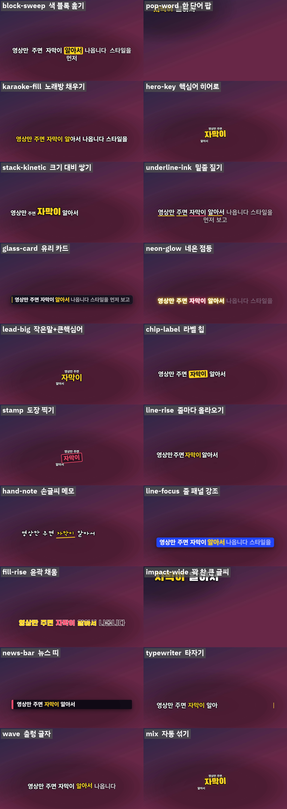

<p align="center"></p>

<p align="center">
<a href="https://github.com/reedodev/dynamic-captions/actions/workflows/test.yml"></a>


</p>

# 다이나믹 자막 (dynamic-captions)

영상(말하는 영상, 랩·노래 가사 영상, 쇼츠, 롱폼)을 주면 말과 가사를 단어 단위로 받아 적고, 같은 장면에 **19가지 자막 스타일과 문장마다 스타일을 바꾸는 자동 섞기** 시안을 먼저 보여 줍니다. 마음에 드는 스타일을 고르면 자막이 박힌 mp4와 투명 자막(.mov)을 만듭니다.

- **자막이 왼쪽·오른쪽·위·아래로 돌아가며 나옵니다.** 그래도 유튜브 자막(CC)이 뜨는 화면 아래와 쇼츠·릴스의 앱 버튼 자리는 비워 둡니다. 자기 자리를 벗어나면 렌더를 멈춥니다.
- **얼굴을 피합니다.** 얼굴을 찾아 자막이 얼굴을 가리지 않는 자리를 고릅니다.
- **글씨가 작아지지 않습니다.** 1080p에서 40px 아래로 줄어들면 더 넓은 자리로 옮깁니다.
- **노래에 맞춥니다.** 박마다 자막이 살짝 커지고, 반복되는 후렴은 크게 나옵니다.
- **가사 철자를 맞춥니다.** 받아쓰기가 틀려도 가사 대본의 글자와 소리의 시간을 합칩니다. 가사와 소리가 다른 곳은 사람이 들어 확인할 클립으로 뽑아 줍니다.
- **빠릅니다.** 여러 Chrome이 프레임을 나눠 그려서 75초 1080p 영상이 약 3배 빨라졌습니다.

## 무엇이 필요한가요?

| 준비물 | 어디에 쓰나요 | 꼭 필요한가요 |
|---|---|---|
| Node.js 18 이상 | 모든 스크립트 | 필수 |
| ffmpeg와 ffprobe (PATH) | 영상 읽기, 자막 합성 | 필수 |
| Chrome 또는 Chromium (못 찾으면 `CHROME=<경로>`) | 자막을 그리는 화면 | 필수 |
| Python 3.10+ 와 `pip install openai-whisper numpy` | 받아쓰기 | 필수(단어 시간표가 따로 있으면 생략) |
| `pip install librosa` | 노래 박자 | 선택 |
| `pip install opencv-python-headless` | 얼굴 찾기 | 선택 |
| 대본이나 가사 텍스트 | 철자 맞추기 | 권장 |
| NVIDIA 그래픽카드 | 빠른 인코딩 | 선택 |

자세한 표는 [SKILL.md의 준비물](skills/dynamic-captions/SKILL.md#준비물-쓰기-전에-있어야-하는-것)에 있습니다.

## 바꿔 쓰기

에이전트에게 다음처럼 말하면 옵션을 바꿔서 실행합니다.

- "자막을 더 크게" → `--scale 1.4`
- "자막이 한쪽에만 나오게" → `--pos fixed` 또는 `--pos bottom-left`
- "배경이 밝아서 안 보여" → `--shade 0.5`
- "인물 얼굴을 가리지 마" → `find-faces.py` 후 `--faces faces.json`
- "노래 박자에 맞춰" → `detect-beat.py` 후 `--beat beat.json`
- "빨리 만들어줘" → `--workers 4 --encoder auto`

전체 표는 [SKILL.md의 바꿔 쓰기](skills/dynamic-captions/SKILL.md#바꿔-쓰기-이렇게-말하세요)에 있습니다.

## 설치

**Claude Code 플러그인으로 설치**

```
/plugin marketplace add reedodev/dynamic-captions
/plugin install dynamic-captions@dynamic-captions
```

**폴더만 복사**

```bash
git clone https://github.com/reedodev/dynamic-captions.git
cp -r dynamic-captions/skills/dynamic-captions ~/.claude/skills/
```

## 바로 해 보기

```bash
S=skills/dynamic-captions/scripts
python $S/transcribe.py my.mp4 --out words.json --lang ko            # 받아쓰기
node $S/make-captions.mjs --video my.mp4 --words words.json --out job --scale 1.25 --shade 0.4
node $S/render.mjs preview job                                       # 19개 스타일 시안: job/preview/overview.png
node $S/render.mjs final job --style mix --range 0,20 --encoder auto # 20초 샘플
```

시안(`overview.png`)을 보고 스타일을 고른 뒤 `--style <id>`로 전체를 만듭니다. 에이전트가 [SKILL.md](skills/dynamic-captions/SKILL.md)를 읽고 이 순서(받아쓰기 → 철자 맞추기 → 직접 듣기 확인 → 시안 → 최종 렌더 → 검수)를 그대로 따릅니다.

## 시험

`node tests/run.mjs`가 SKILL.md 형식을 검사하고, 합성 영상으로 자막 만들기·시안 19종·최종 렌더·병렬 렌더·철자 맞추기·직접 듣기 클립을 실제로 돌립니다. 푸시할 때마다 GitHub Actions가 같은 시험을 돌립니다(위 test 배지). 받아쓰기(Whisper) 자체는 시험에 넣지 않았습니다.

## 알려진 한계

- AI는 소리를 직접 듣지 못합니다. 가사나 말과 소리가 맞는지는 사람이 `listen-check` 클립으로 확인해야 합니다.
- 랩·노래의 단어 시간은 Whisper 기반이라 거칩니다(단어 하나를 최대 1.8초로 제한). 한국어 강제 정렬은 없습니다.
- 얼굴은 사람 정면 얼굴만 찾습니다. 만화·동물·뒷모습은 놓칠 수 있고, 얼굴 말고 손·제품·몸은 피하지 않습니다.
- 자막 스타일 취향과 시청 효과는 검증하지 않았습니다. 시안을 보고 직접 고르세요.

구현 메모와 시험 수치는 [styles.md](skills/dynamic-captions/references/styles.md)에 있습니다.

<!-- credits -->
## 출처와 영감

- [JIZURA](https://852wa.github.io/JIZURA/)(MIT)의 가사 타이포 방식과 [sequence_ai의 공개 영상](https://www.threads.com/@sequence_ai/post/De25KQAD6G7)에서 보인 문장별 스타일 변화를 영감으로 삼았습니다. 코드는 옮기지 않았고 유료 상품은 구매하지 않았습니다.
- 규칙과 수치를 참고한 오픈소스 자막 도구 15곳, 사용한 라이브러리(Whisper, librosa, OpenCV, YuNet 얼굴 모델), 글꼴 4종(SIL OFL)은 [references/sources.md](skills/dynamic-captions/references/sources.md)에 라이선스와 함께 있습니다.

## 만든 사람

**리도**, AI 좌충우돌 실습 중인 20년차 엔지니어입니다. 매일 영상을 만들다가 막힌 부분을 고쳐 가며 이 스킬을 만들었습니다.
[YouTube @Reedodev](https://www.youtube.com/@Reedodev) · [Threads @reedo.dev](https://www.threads.com/@reedo.dev) · [GitHub @reedodev](https://github.com/reedodev)

---

## English

Give it a video (talking head, rap or song lyrics, Shorts, long form). It transcribes speech or lyrics word by word, shows **19 caption styles plus an auto-mix that changes style sentence by sentence** on the same scene, and after you pick one it renders a captioned mp4 and a transparent caption track (.mov).

- Captions move between left, right, top and bottom, but always stay out of the YouTube-caption area and the app-button areas of Shorts/Reels. A caption that leaves its spot stops the render.
- Face-aware (YuNet face model), minimum text size, beat pulse and automatic big chorus lines for songs, lyric spelling taken from your script while timing stays with the audio, a clip generator that lets a human listen to the places where lyrics and sound disagree, and parallel rendering (about 3x faster on a 75 s 1080p clip).

Install: `/plugin marketplace add reedodev/dynamic-captions` then `/plugin install dynamic-captions@dynamic-captions`, or copy `skills/dynamic-captions` into `~/.claude/skills/`. Needs Node 18+, ffmpeg, Chrome/Chromium, Python 3.10+ with `openai-whisper` (optional: `librosa`, `opencv-python-headless`). See [SKILL.md](skills/dynamic-captions/SKILL.md) for the full procedure. The agent cannot hear: lyric/sound agreement must be checked by a person. MIT License; bundled fonts (SIL OFL) and the YuNet model keep their own licenses, see [sources.md](skills/dynamic-captions/references/sources.md).
